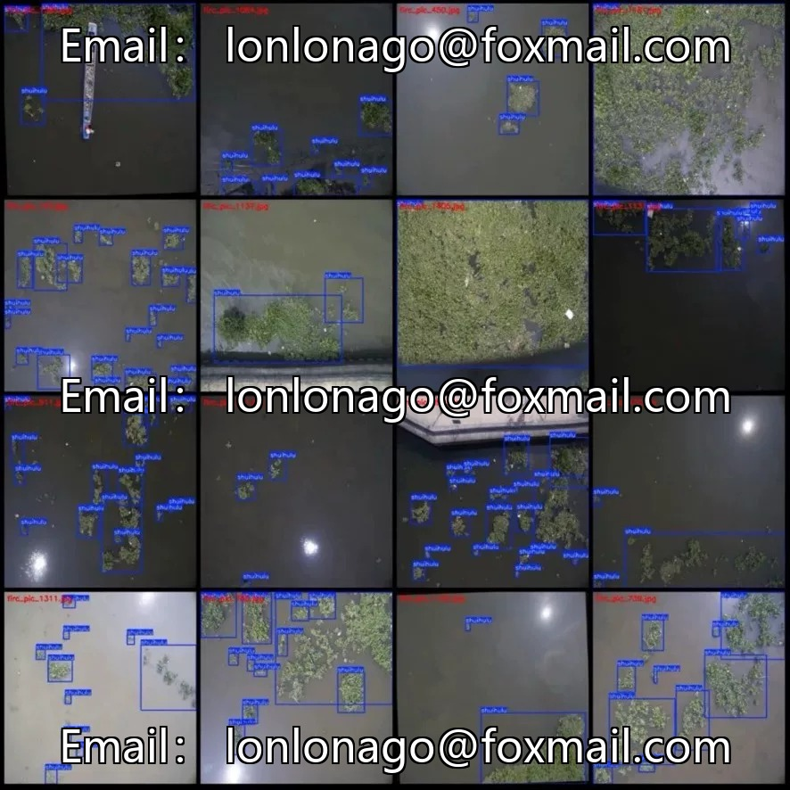
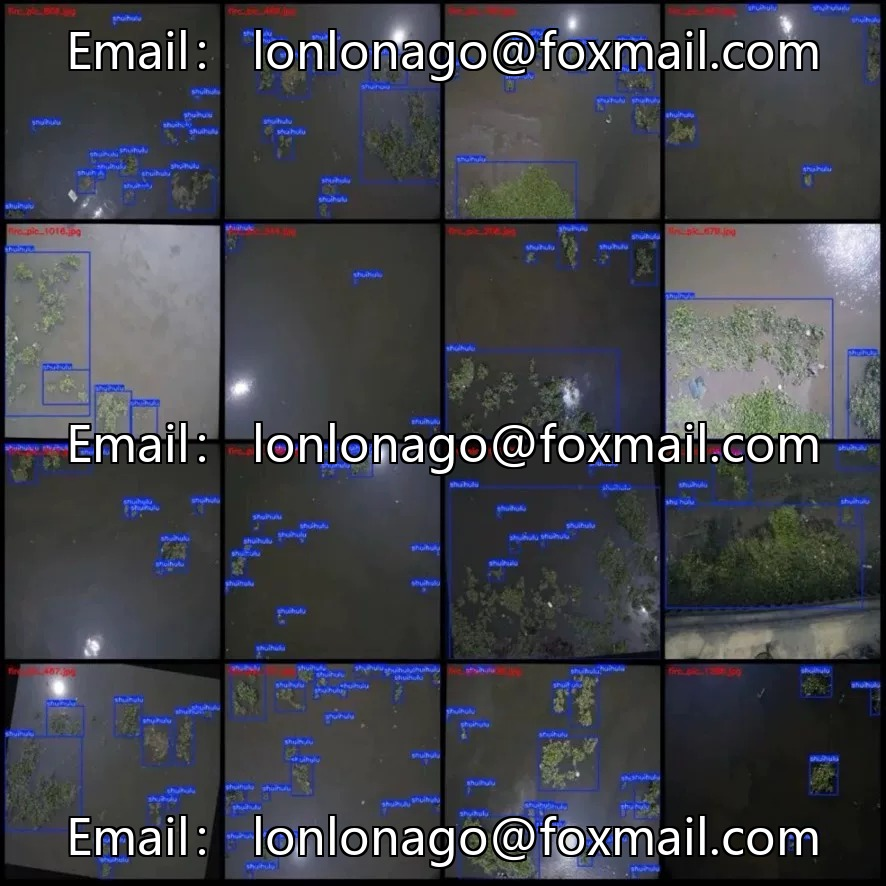
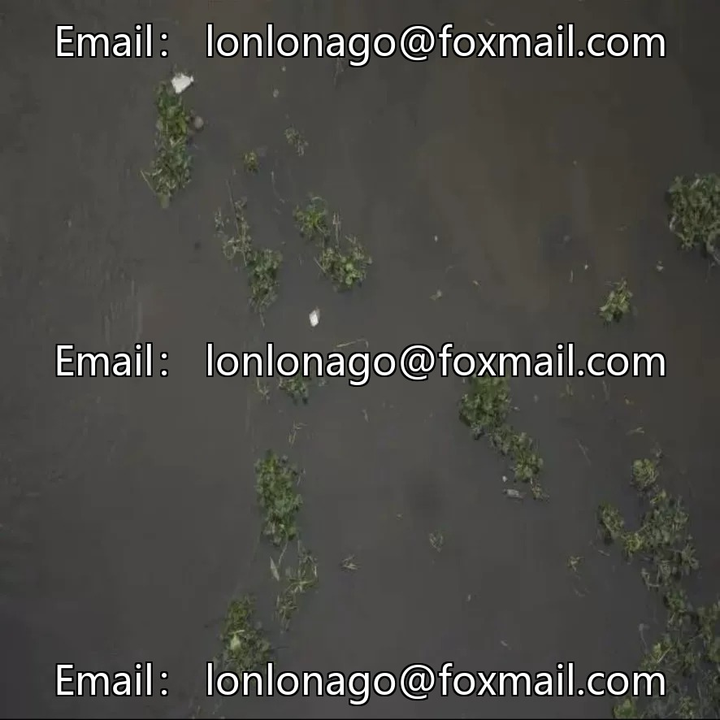

# Drone Water Lily Detection Dataset

## Body

Drone Water Hyacinth Detection Dataset | 1417 images, single-category, high-density coverage

1417 aerial photos, 640×640 resolution, single-category "Eichhornia". Total bounding boxes 10845, an average of 7.6 target areas per image - in rivers and lakes, Eichhornia typically spreads in large patches, multiple clusters are common in each image.

Application scenarios: River channel inspection, lake ecological monitoring, water conservancy facility maintenance. Eichhornia crassipes is an invasive species, and its excessive reproduction can block waterways, consume oxygen in water, and disrupt ecological balance. Drone aerial photography combined with AI detection can quickly locate the outbreak area, which is much more efficient than manual riverside inspections.

Detection difficulty: Water hyacinths appear as green patches on the surface of the water, which can easily be confused with floating plants, aquatic vegetation, and shoreline vegetation. Different light conditions and growth densities result in significant morphological differences (sparse floating vs dense coverage). Univariate detection can only locate "whether there is water hyacinth". If you want to distinguish the growth density and spreading trend, additional data is needed.

Each image is labeled, without division into training, validation, or test sets. Divide them according to an 8:1:1 ratio yourself. A resolution of 640×640 is sufficient for the panoramic view of water hyacinths from an aerial perspective. Suitable for river channel ecological inspection, smart water conservancy, and monitoring of alien species.

Virtual materials, once sold, are non-refundable.
Interested friends, click "I want" to proceed.

## Images

## Payment

Here is a pay link on Stripe ( https://buy.stripe.com/3cs8yP7sY87d0vu9AB ). Please contact me lonlonago@foxmail.com after funding $89, and I will send you a complete data files , thank you!

